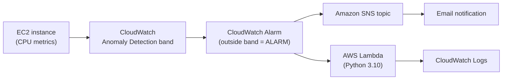

# AWS AIOps Anomaly Detection and Alerting Pipeline

A small AWS project that uses CloudWatch Anomaly Detection to watch EC2 CPU usage, then sends an email alert and runs a Python Lambda function when CPU behaves outside its normal pattern.

Everything was built from the AWS Management Console and CloudShell. Nothing runs on a local machine, and no ML code was written or trained by me. The machine learning is the built-in CloudWatch Anomaly Detection feature.

## The problem

Most CPU alerts use a fixed limit, such as "alert if CPU is above 80%". A fixed limit cannot tell the difference between a busy afternoon and a strange spike at 3am. The result is false alarms during normal peaks, and real problems that sit just under the limit.

## What this project does

CloudWatch Anomaly Detection learns the normal CPU pattern of an EC2 instance and draws an expected band around the metric. An alarm watches that band. When CPU moves outside it, the alarm changes to the ALARM state and two things happen:

1. An email is sent through Amazon SNS.
2. A Lambda function is invoked and writes the alarm details to its CloudWatch Logs.

## Architecture



The alarm has two separate actions. SNS sends the email. Lambda is invoked directly by the alarm, and it does not send anything to SNS. The Lambda function only parses and logs the event for now.

## Services used

| Service | Role |
| --- | --- |
| Amazon EC2 (t2.micro or t3.micro, Ubuntu 22.04 LTS) | Target server that produces CPU metrics |
| CloudWatch Anomaly Detection | Learns normal CPU behaviour and builds the expected band |
| CloudWatch Alarm | Changes to ALARM when CPU is outside the band |
| Amazon SNS | Sends the alert email |
| AWS Lambda (Python 3.10) | Receives the alarm event and logs the details |

## Setup steps

### 1. Launch the EC2 instance

1. In the AWS Console, open EC2 and click **Launch instance**.
2. Name it `aiops-demo-server`.
3. Choose **Ubuntu 22.04 LTS** and instance type **t2.micro** (or t3.micro).
4. Launch it and wait for it to reach the running state.

### 2. Turn on Anomaly Detection for CPU

1. Open CloudWatch, then **Metrics** and **All metrics**.
2. Go to **EC2** and **Per-Instance Metrics**, and tick **CPUUtilization** for `aiops-demo-server`.
3. Open the **Graphed metrics** tab, click **Add math**, and choose **Anomaly detection**.
4. An orange band appears on the graph. That band is the expected range.

The model needs history before the band is useful. In my case it had not finished training when I tested, so the alarm showed INSUFFICIENT_DATA at first (see the testing section).

### 3. Create the SNS topic

1. Open SNS, go to **Topics** and **Create topic**.
2. Choose **Standard** and name it `aiops-anomaly-alerts`.
3. Create a subscription with protocol **Email** and your own email address.
4. Open the confirmation email and click **Confirm subscription**.

### 4. Create the Lambda function

1. Open Lambda and click **Create function**, then **Author from scratch**.
2. Name it `AIOps-Anomaly-Handler`, choose **Python 3.10**, and let it create a new role with basic Lambda permissions.
3. Paste the code below into the code editor and click **Deploy**.

```python
import json

def lambda_handler(event, context):
    print("AIOps Engine Received Anomaly Event:")
    print(json.dumps(event))

    # Pull details out of the CloudWatch alarm payload
    alarm_name = event.get('alarmData', {}).get('alarmName', 'CloudWatch Anomaly Alarm')
    state_reason = event.get('alarmData', {}).get('state', {}).get(
        'reason', 'CloudWatch detected an anomaly in the metric.'
    )

    message = f"AIOps Alert: Anomaly Detected\n\nAlarm: {alarm_name}\nDetails: {state_reason}"
    print(message)

    return {
        'statusCode': 200,
        'body': json.dumps('AIOps event processed')
    }
```

The function only logs the event. This is the place where real automated actions would go, such as restarting a service or opening a ticket.

### 5. Create the alarm

1. In CloudWatch, go to **Alarms** and **Create alarm**.
2. Click **Select metric**, then **EC2**, **Per-Instance Metrics**, and choose **CPUUtilization** for `aiops-demo-server`.
3. For the condition, choose **Anomaly detection** and set it to alarm when the metric is **outside the band**. I set the anomaly detection threshold to 20.
   - Under additional configuration, I set **Missing data treatment** to **Treat missing data as bad (breaching threshold)**. I did this so the alarm would not sit in INSUFFICIENT_DATA while the model was still training. This is a demo shortcut, not a normal production setting.
4. Under notifications, choose the **In alarm** state and select the `aiops-anomaly-alerts` SNS topic.
5. Add a **Lambda action** for the **In alarm** state and select `AIOps-Anomaly-Handler`.
6. Name the alarm `aiops-cpu-anomaly-alarm` and create it.

I also created a custom policy for the Lambda function so the alarm could run it. If the Lambda action fails, check that the function allows invocation from CloudWatch alarms. The resource-based policy on the function needs to allow the principal `lambda.alarms.cloudwatch.amazonaws.com` to run `lambda:InvokeFunction`.

The email subscription on the SNS topic also has to be confirmed from your inbox before alert emails will arrive.

## How I tested it

Right after I created the alarm, it showed INSUFFICIENT_DATA, because the anomaly detection model had not finished training and can take hours to be ready. To check the whole pipeline in one sitting, I changed the missing data treatment to **Treat missing data as bad (breaching threshold)**, as described in step 5.

Then I connected to the instance and ran the `stress` command to push CPU usage up:

```bash
sudo apt install stress -y
stress --cpu 1 --timeout 600
```

The alarm moved to ALARM, an email arrived through SNS, and the Lambda log stream showed the alarm event.

Because of the missing data setting, this test shows that the alarm, SNS and Lambda are wired together correctly. It does not prove that the trained model's band caught the CPU spike on its own.

## Screenshots

**1. The EC2 instance being monitored**


**2. CloudWatch alarm in the ALARM state**


**3. CPU graph during the stress test, with the anomaly detection band**


**4. Lambda log stream showing the alarm event**


**5. SNS alert email in the inbox**


## Limitations

- The Lambda function only logs the alarm details. It does not fix anything yet.
- The test uses artificial load from `stress`, not real production traffic.
- The demo alarm was set to treat missing data as breaching, so it fired before the model had fully trained. A proper test would wait for the band to form, then apply load and check that the alarm fires because CPU leaves the band.
- Anomaly Detection needs enough metric history to build a useful band, so a brand new instance may give poor results at first.
- This is a single-instance demo. It is not a production monitoring setup.

## Ideas for next steps

- Have the Lambda function restart a service or reboot the instance.
- Send a formatted alert from Lambda through SNS.
- Re-run the test after the model has trained, with missing data treatment back on its default.
- Create the whole setup with CloudFormation or Terraform.
- Add an alarm for memory or disk usage.

## Cost and cleanup

The project uses services that have Free Tier allowances, but limits and pricing change, so check the current AWS pricing pages. When you finish, delete the resources so nothing keeps running:

1. Terminate the EC2 instance.
2. Delete the CloudWatch alarm and the anomaly detection model.
3. Delete the SNS topic and its subscription.
4. Delete the Lambda function and its log group.
